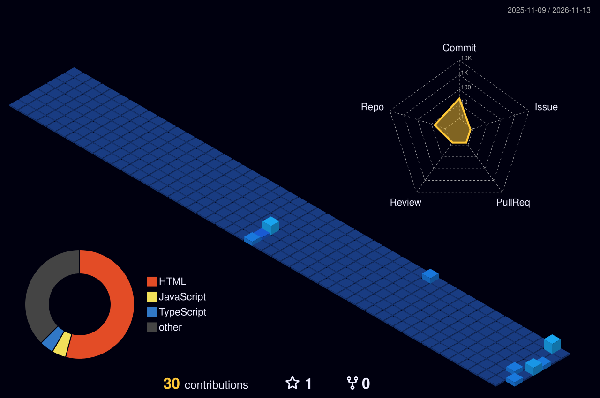

<!-- Banner (animated waves) -->
<div align="center">


<a href="https://git.io/typing-svg">
  
</a>

<br/><br/>

[](https://sayyidmidlaj.vercel.app)
[](https://linkedin.com/in/sayyid-midlaj-0b108341)
[](mailto:midlajsyd@gmail.com)


</div>

---

## 👋 About me

```python
class Syd:
    name     = "Sayyid Midlaj"
    role     = "Python Full Stack Intern @ Techolas, Kochi"
    stack    = ["Python", "Django", "React", "SQL"]
    based_in = "Kerala, India"
    learning = ["three.js", "GSAP", "Scroll animations"]
    status   = "Open to internships & junior developer roles 🚀"

    def motto(self):
        return "Clean backend, responsive frontend, ship it."
```

I build data-driven web apps with Python and Django on the backend and React on the front. A sociology background taught me to think about *who* I'm building for, not just *what* I'm building.

---

## 🛠️ Tech Stack

<div align="center">

<a href="https://skillicons.dev">
  
</a>

</div>

---

## 🚀 Featured Projects

<div align="center">

| Project | What it is | Tech |
|---|---|---|
| 🌐 **[Personal Portfolio](https://sayyidmidlaj.vercel.app)** | Showcase of my projects, skills and contact details | Next.js · Tailwind · Vercel |
| ✈️ **[Malabar Voyages](https://malabar-voya.vercel.app)** ([code](https://github.com/midlajsyd/malabar-voya)) | Responsive Kerala travel site with destinations, tour packages, testimonials and a booking flow | HTML · CSS · Bootstrap |
| ⚙️ **Full Stack App** *(in progress)* | Data-driven app with authentication, CRUD operations and a relational database | Python · Django · SQL |

</div>

---

## 📊 GitHub Stats

<div align="center">


</div>

### 🧊 3D contribution graph

<div align="center">



</div>

### 🐍 Contribution snake

<div align="center">

<picture>
  <source media="(prefers-color-scheme: dark)" srcset="https://raw.githubusercontent.com/midlajsyd/midlajsyd/output/github-snake-dark.svg" />
  <source media="(prefers-color-scheme: light)" srcset="https://raw.githubusercontent.com/midlajsyd/midlajsyd/output/github-snake.svg" />
  
</picture>

</div>

---

## 🎬 3D playground

<div align="center">

<!-- Record a short screen capture of your three.js scene, save it as assets/3d-demo.gif, and it shows up here -->
<a href="https://sayyidmidlaj.vercel.app">
  
</a>

</div>

---

## 🎯 Currently

- 🔭 Building my full stack Django project
- 🌱 Leveling up React and exploring 3D / scroll animations (three.js, GSAP)
- 💼 Looking for an internship or junior developer role
- 📫 Best way to reach me: [email](mailto:midlajsyd@gmail.com) or [LinkedIn](https://linkedin.com/in/sayyid-midlaj-0b108341)

<div align="center">


</div>
